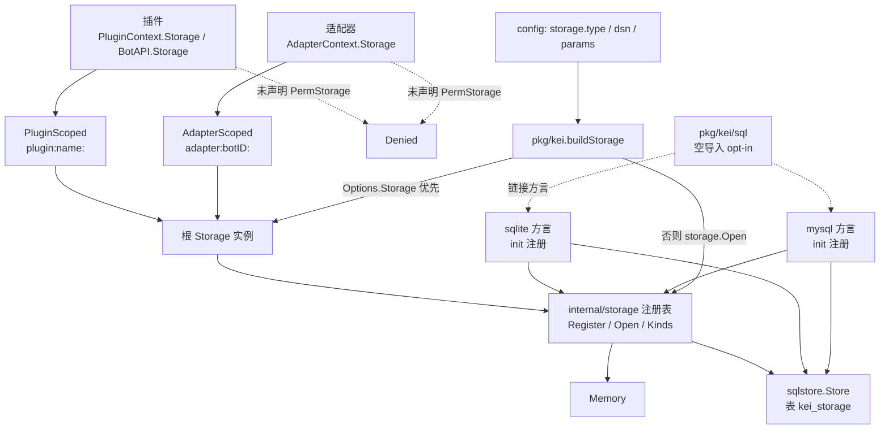

# Storage 存储模块

`Storage` 是 kei 暴露给插件与适配器的唯一键值存储抽象：一次装配只有一个根实例，插件/适配器经权限裁剪拿到带命名空间前缀的视图或拒绝式实现；后端通过 `init()` 注册表可插拔，内置 `memory`、`sqlite`、`mysql` 三种。

本文覆盖存储模块的公开契约、后端实现、注册与装配、键空间隔离、生命周期、配置与扩展边界。插件侧 `PluginContext.Storage` 的权限语义见 [`plugin.md`](plugin.md) 11.2，配置键全表见 [`configuration.md`](configuration.md) 12.5，适配器侧裁剪见 [`adapter.md`](adapter.md) 6.3。本文是模块文档，节号只用于本文内部引用，不占用早期设计稿的 1-19 章号。

不覆盖：业务数据的表结构设计（Storage 只提供 KV）、去重与限流内部实现（分别见 `internal/dedup`、`internal/ratelimit`）、插件如何声明权限（见 [`plugin.md`](plugin.md) 9.1）。

---

## 1. 设计目标与分层



四层职责：

1. **公开契约**（`pkg/bot`）：`Storage` 接口、`ErrNotFound`、`ErrPermissionDenied`。插件与适配器只依赖这一层。
2. **分发与隔离**（`internal/storage`）：`PluginScoped`/`AdapterScoped` 给键加前缀，`Denied` 在未授权时拒绝访问，`CheckKey` 统一键长上限。
3. **后端实现**：`Memory` 是默认的进程内实现；`sqlstore` 是 GORM 通用 SQL 实现；`sqlite`/`mysql` 只负责方言构造与注册。
4. **装配**（`pkg/kei`）：`buildStorage` 决定使用注入实例还是按配置构造，并把根实例交给引擎、适配器管理器与插件管理器。

核心原则：**一个根实例、视图隔离、后端可替换、契约最小**。Storage 不提供事务、枚举、CAS 或多键操作；需要这些能力应由上层组合或自定义实现解决。

## 2. 公开契约

定义在 `pkg/bot/api.go`：

```go
var ErrNotFound = errors.New("bot: storage: key not found")
var ErrPermissionDenied = errors.New("bot: permission denied")

type Storage interface {
	Get(ctx context.Context, key string) ([]byte, error)
	Set(ctx context.Context, key string, value []byte, ttl time.Duration) error
	Delete(ctx context.Context, key string) error
}
```

| 操作 | 约定 |
| --- | --- |
| `Get` | 键不存在或已过期返回可被 `errors.Is(err, bot.ErrNotFound)` 识别的错误；返回值是副本 |
| `Set` | `ttl <= 0` 表示永不过期；入参被拷贝；已存在的键覆盖 |
| `Delete` | 键不存在返回 nil，不报错 |
| `ctx` | 所有实现必须尊重取消；`Memory` 在入口检查 `ctx.Err()`，SQL 后端把 ctx 传给 GORM |
| 并发 | 实现必须并发安全；`Memory` 用 `sync.RWMutex`，SQL 后端依赖 GORM/连接池 |
| 键长 | 底层键上限 191 字节；内置后端对超长键统一拒绝（见第 6 节） |

`Denied()` 是未声明 `PermStorage` 时注入的实现，三个方法都返回 `bot.ErrPermissionDenied`。这是公开哨兵，插件/适配器可用 `errors.Is(err, bot.ErrPermissionDenied)` 判定。

自定义 `bot.Storage` 实现必须自己满足上述语义。`internal/storage` 的 `CheckKey` 只约束内置后端；第三方实现应主动保证同样的键长与错误行为，避免出现「只有某个后端拒绝某个键」的差异。

## 3. 内置后端

### 3.1 Memory

`internal/storage/memory.go` 是默认后端，数据只存活于进程内，重启即丢失。

- 结构：`Memory{mu sync.RWMutex; items map[string]item; now func() time.Time; stop; stopOnce; wg}`；`item{value []byte; expires time.Time}`，零值 `expires` 表示永不过期。
- 构造：`NewMemory()` 使用 `defaultCleanupInterval = time.Minute`；`NewMemoryWithCleanup(interval)` 指定间隔，`interval <= 0` 不启动后台 goroutine。
- `Get`：入口检查 ctx，然后 `CheckKey`；命中但已过期同样返回 `bot.ErrNotFound`。读取返回副本。
- `Set`：入口检查 ctx、`CheckKey`，拷贝 value；`ttl > 0` 时写入 `now().Add(ttl)`，否则 `expires` 保持零值。
- `Delete`：入口检查 ctx、`CheckKey`；不存在时直接返回 nil。
- `Len`：返回 `len(items)`，**包含尚未被清理的过期条目**。
- 后台清理：`janitor` 按间隔调用 `sweep`，删除 `expires` 非零且不晚于当前时间的条目；`Close` 关闭 `stop` 并等待 goroutine 退出，可重复调用。
- 过期读取：`Get` 只判定、不删除；`cleanup_interval: 0` 时过期条目会一直留在 map 中，直到被后续 `Set` 覆盖或 `Memory` 实例被丢弃。
- `Close` 的语义是「停止后台清理」，当前实现没有关闭标志：关闭后 `Get`/`Set`/`Delete` 仍可继续工作，只是不再有后台清理；`Close` 不会清空 `items`。

注册入口：

```go
func init() {
	Register("memory", func(cfg *bot.Config, _ *slog.Logger) (bot.Storage, error) {
		return NewMemoryWithCleanup(cfg.Duration("cleanup_interval", defaultCleanupInterval)), nil
	})
}
```

### 3.2 SQL 通用实现 sqlstore

`internal/storage/sqlstore` 供 SQLite 与 MySQL 共用，表模型固定：

```go
type Entry struct {
	Key       string     `gorm:"column:key;primaryKey;size:191"`
	Value     []byte     `gorm:"column:value;not null"`
	ExpiresAt *time.Time `gorm:"column:expires_at;index"`
}

func (Entry) TableName() string { return "kei_storage" }
```

- **建表**：`New`/`NewWithClock` 调 `AutoMigrate(&Entry{})`。`New` 取得 `*gorm.DB` 的所有权：成功后由 `Store.Close` 关闭连接池；`AutoMigrate` 失败时由 `New` 立即关闭并返回 `errors.Join(建表错误, 关闭错误)`，调用方不需要再关闭。
- **Get**：`CheckKey` 后用 `clause.Eq` 按主键查询（`key` 是 MySQL 8 保留字，字符串条件会被原样下发导致语法错误）；`gorm.ErrRecordNotFound` 转 `bot.ErrNotFound`。命中过期行时带 `expires_at IS NOT NULL AND expires_at <= ?` 谓词惰性删除，避免并发 `Set` 写入的新值被误删；删除失败只记 Debug，返回值仍是 `bot.ErrNotFound`。
- **Set**：`CheckKey`；`nil` value 归一为空 BLOB（`value` 列 `NOT NULL`，nil 会被绑定成 SQL NULL）；拷贝入参后用 `OnConflict` upsert `value`/`expires_at`；`ttl > 0` 写入过期时间，否则为 NULL。
- **Delete**：`CheckKey` 后按主键删除；缺键返回 nil。
- **后台清理**：`cleanup > 0` 时启动 janitor，定期 `DELETE ... WHERE expires_at IS NOT NULL AND expires_at <= ?`；失败记 **Warn**（过期行残留意味着表可能无界增长）。`Close` 取消 ctx、等待 janitor、关闭连接池，可重复调用。
- **连接池**：`ApplyPool` 按配置中的 `max_open_conns` / `max_idle_conns` / `conn_max_lifetime` 调整；键缺失时不改动驱动默认值。目前只有 `mysql` 方言调用它。
- **测试时钟**：`NewWithClock` 注入 `now`，测试无需 sleep 即可覆盖 TTL 与惰性清理。

`whereKey` 与 upsert 都使用 `clause` 而不是手写列名，保证方言能正确引用 `key` 列。这是 SQL 后端里唯一需要特别处理保留字的点。

### 3.3 方言包

- `internal/storage/sqlite`：`init()` 注册 `"sqlite"`；`dsn` 是 SQLite 文件路径或 `file:...?params`，为空时报 `storage: sqlite: 缺少 dsn`；使用 cgo 版 `github.com/mattn/go-sqlite3`，构建需 `CGO_ENABLED=1`；不调用 `ApplyPool`。
- `internal/storage/mysql`：`init()` 注册 `"mysql"`；`dsn` 形如 `user:pass@tcp(host:3306)/db?parseTime=true`，为空时报 `storage: mysql: 缺少 dsn`；`parseTime=true` 是 `expires_at` 能扫描为 `time.Time` 的前提，核心不校验，缺失由驱动报错；`ApplyPool` 失败时关闭连接池并返回合并错误。
- 两个方言包都只把 DSN 交给 GORM，然后调用 `sqlstore.New(db, cleanup_interval, logger)`；清理间隔默认 `1m`，`0` 关闭后台清理。
- `pkg/kei/sql` 是唯一显式 opt-in 入口，只做空导入；未导入时只有 `memory` 注册，配置 `sqlite`/`mysql` 会在装配期报未知类型。这样可以避免不使用 SQL 后端的二进制引入 GORM 与 cgo。

## 4. 注册表与装配

### 4.1 注册表

`internal/storage/registry.go`：

```go
type Opener func(cfg *bot.Config, logger *slog.Logger) (bot.Storage, error)

func Register(kind string, opener Opener)
func Open(kind string, cfg *bot.Config, logger *slog.Logger) (bot.Storage, error)
func Kinds() []string
```

- `Register`：`kind` 为空或 `opener` 为 nil 直接 panic；重复注册也 panic。注册发生在各后端包的 `init()`，属于启动期编程错误，运行期不动态增删。
- `Open`：`logger` 为 nil 时使用 `slog.Default()`；未知类型返回 `storage: 未知存储类型 %q（已注册: ...）`，已注册列表升序、逗号分隔。
- `Kinds`：返回升序快照；当前内置三种为 `memory`、`mysql`、`sqlite`（SQL 方言被链接时）。
- 注册表是包级只读注册表，不承载实例数据；实例状态全部挂在 `Memory`/`Store` 上。

由于 `Register` 位于 `internal/storage`，**注册表只服务仓库内后端**；第三方无法 import `internal/`，不能注册新类型，只能经 `kei.Options.Storage` 注入实例（见第 9 节）。

### 4.2 装配链路

`pkg/kei/assemble.go` 的 `buildStorage`：

1. `Options.Storage != nil`：直接使用注入实例，返回 no-op 清理函数。所有权归调用方，`Run` 不关闭。
2. 否则构造参数：复制 `cfg.Storage.Params`，若 `cfg.Storage.DSN` 非空则加入 `params["dsn"]`。
3. 调 `storage.Open(cfg.Storage.Type, bot.NewConfig(params), logger)`；错误包装为 `kei: 初始化 storage: ...`。
4. 若实例实现 `interface{ Close() error }`，返回对应的关闭函数；否则关闭函数为 no-op。

`pkg/kei.Run` 的顺序是：加载配置 → `buildStorage` → 构造适配器/插件 → `engine.New` → `eng.Run`。自建存储的关闭函数由 `Run` 的 `defer` 执行；若 `eng.Run` 返回 `engine.ErrShutdownIncomplete`（事件总线未在预算内排空），`Run` 保留该实例不关闭，避免在途 handler 访问已关闭的连接或文件。

`engine.New` 自己也有一条兜底：`Options.Storage == nil` 时创建 `storage.NewMemory()` 并标记 `ownStorage = true`；引擎只关闭自己创建的存储（`closeOwnStorage`），调用方注入的实例不归引擎所有。正常经 `pkg/kei.Run` 启动时不会走到这条兜底，因为 `buildStorage` 总能给出实例。

### 4.3 配置解码与校验

`internal/config/config.go`：

```go
type StorageConfig struct {
	Type   string         `yaml:"type"`
	DSN    string         `yaml:"dsn"`
	Params map[string]any // type/dsn 之外的键
}
```

- `storage` 段整体可省略或为 `null`，`applyDefaults` 把空 `type` 填为 `memory`。
- `type` 必须匹配 `^[a-z0-9_-]+$`；是否存在不在配置层校验，由装配期 `storage.Open` 判定。
- `dsn` 是否必填不在配置层校验，由各后端 opener 负责。
- 已知参数在配置层校验，与 `type` 无关：`cleanup_interval` 被三个内置后端使用，`max_open_conns`/`max_idle_conns`/`conn_max_lifetime` 只被 MySQL 使用；类型不符、非整数或负数直接报错，路径为 `storage.params.<key>`。
- 未列出的键原样进入 `Params` 透传给后端，不报错，这是第三方后端的扩展空间；内置后端会忽略不认识的键。
- 环境变量覆盖：`KEI_STORAGE_TYPE`、`KEI_STORAGE_DSN`、`KEI_STORAGE_PARAMS_<KEY>`；空白值等同未设置。

配置键的完整语义与默认值以 [`configuration.md`](configuration.md) 12.5 为准，本节只列存储模块需要知道的装配事实。

## 5. 权限与键空间隔离

运行期分发点有三处，全部在核心内部：

| 消费方 | 条件 | 拿到的视图 |
| --- | --- | --- |
| `internal/engine.pluginAPI`（`BotAPI.Storage()`） | 声明 `PermStorage` | `PluginScoped(name, e.store)` |
| `internal/pluginmgr.contextFor`（`PluginContext.Storage`） | 声明 `PermStorage` 且 `Deps.Storage != nil` | `PluginScoped(meta.Name, deps.Storage)` |
| `internal/adaptermgr.buildInProcess`（`AdapterContext.Storage`） | 声明 `PermStorage` 且 `Deps.Storage != nil` | `AdapterScoped(bc.Name, deps.Storage)` |
| 以上任一未满足 | — | `Denied()` |

- 插件前缀：`plugin:<插件名>:`；适配器前缀：`adapter:<botID>:`（`botID` 即 `bots[].name`）。前缀由框架注入，插件/适配器按逻辑键原样调用，不需要自己拼。
- 同一插件的 `PluginContext.Storage` 与 `BotAPI.Storage()` 使用相同前缀，看到的是同一批键；不同插件、同平台不同 bot 实例之间互不可见。
- `scoped` 是值类型包装器，`Get`/`Set`/`Delete` 都调用 `inner` 并拼接同一前缀；不缓存、不做额外校验，键长校验由底层后端执行。
- 前缀计入 191 字节上限：插件实际可用的逻辑键上限是 `191 - len("plugin:<name>:")`，适配器是 `191 - len("adapter:<botID>:")`。
- `Denied` 不依赖 ctx，三个方法直接返回 `bot.ErrPermissionDenied`；未声明权限的插件/适配器可以在启动后稳定获得该哨兵，便于测试与降级。

## 6. 键长与跨后端一致性

`internal/storage/key.go`：

```go
const MaxKeyBytes = 191
var ErrKeyTooLong = errors.New("storage: 键超过长度上限")

func CheckKey(key string) error
```

- `MaxKeyBytes = 191` 来自 SQL 列定义 `size:191`（MySQL utf8mb4 索引前缀的安全上限）。
- `CheckKey` 按**字节**长度判断，比 MySQL 按字符数的列约束更保守；超长时返回包装 `ErrKeyTooLong` 的错误，错误文本包含字节数、上限和截断到 64 字节的键预览。
- 内存、SQLite、MySQL 三个内置后端都在读写前调用 `CheckKey`，保证同一个键要么在任何后端都能用，要么都返回同一个错误，不会出现「内存/SQLite 能存、只有 MySQL 报错」。
- `Storage` 接口的公开注释要求自定义实现保持同样行为；但 `ErrKeyTooLong` 定义在 `internal/storage`，**外部插件/适配器无法 import 该哨兵**，核心侧与内置后端可用 `errors.Is` 判定，外部侧只能依赖错误文本/统一行为。这是分层规则的直接结果。

跨后端语义对照：

| 行为 | Memory | SQL（sqlite/mysql） |
| --- | --- | --- |
| 缺失键 `Get` | `bot.ErrNotFound` | `bot.ErrNotFound`（`gorm.ErrRecordNotFound` 转换） |
| 过期键 `Get` | 判为不存在，不删除 | 判为不存在，带过期谓词惰性删除；失败只记 Debug |
| `Set` nil value | 接受，存 nil/空值 | 归一为空 BLOB，避免 `NOT NULL` 失败 |
| `Set` 拷贝 | 拷贝入参 | 拷贝入参后 upsert |
| `Delete` 缺键 | nil | nil |
| 后台清理 | janitor 删除过期条目；失败不会发生 | janitor 删除过期行；失败记 Warn |
| `cleanup_interval: 0` | 不启动 janitor；过期条目留在 map | 不启动 janitor；`Get` 仍可惰性删除 |
| `Close` | 停止 janitor，不封禁后续读写 | 停止 janitor 并关闭连接池，后续操作失败 |

## 7. 生命周期与所有权

| 场景 | 实例所有者 | 关闭者 |
| --- | --- | --- |
| `kei.Options.Storage` 注入 | 调用方 | 调用方；`buildStorage` 返回 no-op |
| 按 `storage.type` 构造 | `pkg/kei.Run` | `Run` 的 defer；`ErrShutdownIncomplete` 时保留 |
| 直接构造 `engine.New` 且 `Options.Storage == nil` | 引擎 | `Engine.closeOwnStorage` |
| `pluginmgr`/`adaptermgr` 视图 | 根实例的包装器 | 不拥有，不关闭 |

- `Close` 必须可重复调用：`Memory` 用 `stopOnce`；`Store` 用 `stopOnce` + `database/sql` 连接池的幂等关闭。
- 关闭顺序上，`Run` 先让引擎完成停止（排空总线 → 停插件 → 关自有存储），再关闭门面自建的存储；两者不会重复关闭同一个实例。
- 总线未排空时，引擎跳过插件 Stop 与自有存储关闭并返回 `ErrShutdownIncomplete`；`pkg/kei.Run` 也保留自建的存储，交给进程退出回收。
- `Memory.Close` 不设置关闭标志，只停后台清理；`Store.Close` 会真正关闭数据库连接。两者对「关闭后还能否读写」的行为不同，调用方应以「Close 后不再使用」为契约。

## 8. 扩展方式

### 8.1 仓库内新增内置后端

1. 新建 `internal/storage/<kind>` 包，实现 `bot.Storage`。
2. 在 `init()` 中调用 `storage.Register("<kind>", opener)`；`opener` 从 `*bot.Config` 读取 `dsn`/参数并构造实例。
3. 复用 `storage.CheckKey` 与 `bot.ErrNotFound` 语义；需要 TTL 时自行实现 janitor，并保证 `Close` 幂等。
4. 在 `pkg/kei/sql` 或新的 opt-in 包中按需空导入，避免默认二进制引入额外依赖。
5. 更新本文与 [`configuration.md`](configuration.md) 12.5 的类型/参数表。

### 8.2 第三方自定义实现

第三方不能 import `internal/`，因此不能调用 `Register`；正确方式是实现 `bot.Storage` 并通过 `kei.Options.Storage` 注入：

```go
err := kei.Run(ctx, kei.Options{
	ConfigFile: "config.yaml",
	Storage:    myStore, // 调用方拥有，Run 不关闭
})
```

实现检查清单：

- `Get`/`Set`/`Delete` 并发安全，尊重 ctx。
- `Get` 返回副本，缺失/过期返回可被 `errors.Is(err, bot.ErrNotFound)` 识别的错误。
- `Set` 拷贝入参，`ttl <= 0` 永不过期，已存在键覆盖。
- `Delete` 缺键返回 nil。
- 键长上限与内置后端一致（191 字节，含框架注入的前缀）。
- 需要后台清理时提供幂等 `Close`；若实现 `Close() error`，`buildStorage` 会检测到并在自建场景关闭，但注入场景仍由调用方负责。

`internal/storage` 的注册表不感知第三方实现；配置层也不维护类型白名单，未知 `storage.type` 只在装配期报错。

## 9. 测试与已知边界

测试文件与覆盖点：

| 文件 | 覆盖 |
| --- | --- |
| `internal/storage/memory_test.go` | 往返、TTL、ctx 取消、`Close` 幂等、`Denied`、并发、键长、命名空间隔离、`cleanup_interval` |
| `internal/storage/registry_test.go` | `Kinds` 升序、`Open("memory")`、未知类型报错并列出已注册名 |
| `internal/storage/sqlstore/sqlstore_test.go` | 建表失败回收连接池、`CloseDB` 幂等、MySQL 保留字引用、惰性清理/后台清理失败日志 |
| `internal/storage/sqlite/sqlite_test.go` | 经注册表往返、拷贝语义、缺失键、`Close` 幂等、同文件重开持久化、键长、假时钟 TTL、后台清理 |
| `internal/storage/mysql/mysql_test.go` | 默认 `t.Skip`；设置 `KEI_TEST_MYSQL_DSN` 时跑真实 MySQL 往返与 TTL |

已知边界：

1. **SQL 方言是显式 opt-in**：未空导入 `pkg/kei/sql` 时只有 `memory` 注册；配置 `sqlite`/`mysql` 会在装配期报未知类型，而不是静默回落到内存。
2. **MySQL 测试默认跳过**：需要真实实例与 `KEI_TEST_MYSQL_DSN`，CI 不启动 MySQL。
3. **`Memory.Close` 不是关闭栅栏**：关闭后仍可读写，只是不再后台清理；需要「关闭后拒绝访问」的语义应使用 SQL 后端或自定义实现。
4. **`Memory` 不惰性删除过期条目**：过期键只在 `Get` 时判为不存在，`Len` 仍会计入；SQL 后端会在 `Get` 命中时惰性删除。
5. **`ErrKeyTooLong` 是内部哨兵**：外部插件/适配器无法 `errors.Is` 引用它，只能依赖统一错误文本；公开契约只承诺行为一致，不承诺哨兵可达。
6. **MySQL 的 `parseTime=true` 由调用方保证**：缺失时过期时间列无法扫描为 `time.Time`，驱动会报错；核心不做二次校验。
7. **没有事务、枚举、批量或 CAS 接口**：Storage 的契约刻意保持最小；复杂需求由上层组合或自定义实现承担。
8. **SQL 表结构固定**：`kei_storage` 由 `AutoMigrate` 创建/更新；没有多表、分库或迁移版本管理。

---

## 相关文档

- [`architecture.md`](architecture.md)：目录结构、装配门面与核心分层（第 3、4 章）。
- [`plugin.md`](plugin.md)：`PluginContext.Storage`、`BotAPI.Storage()` 与权限降级（第 9、11 章）。
- [`adapter.md`](adapter.md)：`AdapterContext.Storage` 与适配器权限裁剪（第 6 章）。
- [`configuration.md`](configuration.md)：`storage` 段、参数校验与环境变量覆盖（12.5、12.7）。
- [`engine.md`](engine.md)：事件总线排空与 `ErrShutdownIncomplete` 对存储关闭的影响（7.3）。
- [`testing.md`](testing.md)：存储相关测试清单与质量门命令（第 15、18 章）。
