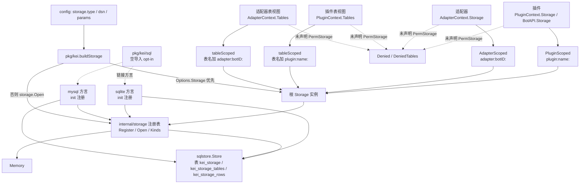

# Storage 存储模块

`Storage` 是 kei 暴露给插件与适配器的唯一键值存储抽象：一次装配只有一个根实例，插件/适配器经权限裁剪拿到带命名空间前缀的视图或拒绝式实现；后端通过 `init()` 注册表可插拔，内置 `memory`、`sqlite`、`mysql` 三种。内置后端同时实现可选的 `TableStorage`（表级与表内 CRUD），表视图同样按前缀隔离，经 `PluginContext.Tables`/`AdapterContext.Tables` 分发。

本文是存储模块的**唯一规范**：公开契约、后端实现、注册与装配、键空间与视图隔离、生命周期、配置语义、扩展边界都以本文为准。其他文档只描述各自领域并链接到这里——插件/适配器上下文的结构体字段见 [`plugin.md`](plugin.md) 11.3 与 [`adapter.md`](adapter.md) 6.1，`storage` 段的配置键、默认值与取值校验见 [`configuration.md`](configuration.md) 12.5，测试清单与质量门见 [`testing.md`](testing.md)。本文节号只用于内部引用，不占用早期设计稿的 1-19 章号。

不覆盖：业务数据建模（表是无 schema 的「键 → 字节串」行集合，不提供列定义）、去重与限流内部实现（分别见 `internal/dedup`、`internal/ratelimit`）、插件如何声明权限（见 [`plugin.md`](plugin.md) 9.1）。

---

## 1. 设计目标与分层



四层职责：

1. **公开契约**（`pkg/bot`）：`Storage`/`TableStorage` 接口、`ErrNotFound`、`ErrPermissionDenied`、`ErrTableNotFound`、`ErrTableExists`、`ErrRowExists`。插件与适配器只依赖这一层。
2. **分发与隔离**（`internal/storage`）：`PluginScoped`/`AdapterScoped` 给键加前缀，`PluginTables`/`AdapterTables` 给表名加同一前缀，`Denied`/`DeniedTables` 在未授权时拒绝访问，`CheckKey`/`CheckTableName`/`CheckRowKey` 统一长度上限。
3. **后端实现**：`Memory` 是默认的进程内实现；`sqlstore` 是 GORM 通用 SQL 实现；`sqlite`/`mysql` 只负责方言构造与注册。
4. **装配**（`pkg/kei`）：`buildStorage` 决定使用注入实例还是按配置构造，并把根实例交给引擎、适配器管理器与插件管理器。

核心原则：**一个根实例、视图隔离、后端可替换、契约最小**。KV 层不提供事务、枚举、CAS 或多键操作；表层只提供表级 CRUD、按表名/行键的读写与升序枚举，没有列 schema、TTL、分页或跨表事务。需要这些能力应由上层组合或自定义实现解决。

## 2. 公开契约

定义在 `pkg/bot/api.go`（KV）与 `pkg/bot/table.go`（表）：

```go
var ErrNotFound = errors.New("bot: storage: key not found")
var ErrPermissionDenied = errors.New("bot: permission denied")

type Storage interface {
	Get(ctx context.Context, key string) ([]byte, error)
	Set(ctx context.Context, key string, value []byte, ttl time.Duration) error
	Delete(ctx context.Context, key string) error
}

var (
	ErrTableNotFound = errors.New("bot: storage: table not found")
	ErrTableExists   = errors.New("bot: storage: table already exists")
	ErrRowExists     = errors.New("bot: storage: row already exists")
)

type TableRow struct {
	Key   string
	Value []byte
}

type TableStorage interface {
	CreateTable(ctx context.Context, table string) error
	ListTables(ctx context.Context) ([]string, error)
	RenameTable(ctx context.Context, oldName, newName string) error
	DropTable(ctx context.Context, table string) error

	InsertRow(ctx context.Context, table, key string, value []byte) error
	GetRow(ctx context.Context, table, key string) ([]byte, error)
	UpdateRow(ctx context.Context, table, key string, value []byte) error
	DeleteRow(ctx context.Context, table, key string) error
	ListRows(ctx context.Context, table string) ([]TableRow, error)
}
```

| 操作 | 约定 |
| --- | --- |
| `Get` | 键不存在或已过期返回可被 `errors.Is(err, bot.ErrNotFound)` 识别的错误；返回值是副本 |
| `Set` | `ttl <= 0` 表示永不过期；入参被拷贝；已存在的键覆盖 |
| `Delete` | 键不存在返回 nil，不报错 |
| `ctx` | 所有实现必须尊重取消；`Memory` 在入口检查 `ctx.Err()`，SQL 后端把 ctx 传给 GORM |
| 并发 | 实现必须并发安全；`Memory` 用 `sync.RWMutex`，SQL 后端依赖 GORM/连接池 |
| 键长 | 底层键上限 191 字节；内置后端对超长键统一拒绝（见第 6 节） |

表接口的语义（内置三个后端一致）：

| 操作 | 约定 |
| --- | --- |
| `CreateTable` | 表必须显式创建；已存在返回 `bot.ErrTableExists` |
| `ListTables` | 按名称的**字节序**升序（Go 字符串比较）；无表返回空切片（len 0，不是 nil） |
| `RenameTable` | 保留行数据；源不存在返回 `bot.ErrTableNotFound`，目标存在返回 `bot.ErrTableExists`；`oldName == newName` 时源存在返回 nil、不存在返回 `ErrTableNotFound` |
| `DropTable` | 删除表及其全部行；表不存在返回 nil（幂等），与 `Delete` 语义一致 |
| `InsertRow` | 不自动建表：表不存在返回 `bot.ErrTableNotFound`，行键已存在返回 `bot.ErrRowExists` |
| `GetRow` | 表不存在返回 `bot.ErrTableNotFound`，行不存在返回 `bot.ErrNotFound`；返回值是副本 |
| `UpdateRow` | 表不存在返回 `ErrTableNotFound`，行不存在返回 `bot.ErrNotFound`；新值等于旧值也是成功（SQL 后端可能报告 0 行受影响） |
| `DeleteRow` | 表不存在返回 `ErrTableNotFound`，行不存在返回 nil |
| `ListRows` | 表不存在返回 `ErrTableNotFound`；按行键的**字节序**升序返回全部行；空表返回空切片；值都是副本 |
| 值拷贝 | `InsertRow`/`UpdateRow` 拷贝入参，`GetRow`/`ListRows` 返回副本；空值（`nil` 或零长度）按空值处理：SQL 写入归一为空 BLOB，两个后端的读取都返回长度为 0 的 `nil` 切片 |
| 名字校验 | 表名（视图前缀计入）与行键都必须非空、按字节 ≤ 191；不做字符集限制、不做大小写归一 |

行键的唯一性只在表内成立：不同表可以有相同行键，行数据由表隔离（SQL 后端用 `(table_id, row_key)` 复合主键表达）。

`Denied()` 是未声明 `PermStorage` 时注入的 KV 实现，三个方法都返回 `bot.ErrPermissionDenied`；`DeniedTables()` 是同一处境下的表实现，九个方法同样返回该哨兵。都是公开哨兵，插件/适配器可用 `errors.Is(err, bot.ErrPermissionDenied)` 判定。

`TableStorage` 是**可选**能力：`Storage` 与 `BotAPI` 的方法集不变，内置后端由同一个根实例实现两个接口；自定义 `bot.Storage` 是否同时实现 `bot.TableStorage` 由实现方决定，未实现时插件/适配器拿到的 `Tables` 为 nil（`PluginTables`/`AdapterTables` 的类型断言失败）。

自定义实现必须自己满足上述语义。`internal/storage` 的 `CheckKey`/`CheckTableName`/`CheckRowKey` 只约束内置后端；第三方实现应主动保证同样的长度与错误行为，避免出现「只有某个后端拒绝某个名字」的差异。

## 3. 内置后端

### 3.1 Memory

`internal/storage/memory.go` 是默认后端，数据只存活于进程内，重启即丢失。

- 结构：`Memory{mu sync.RWMutex; items map[string]item; tables map[string]map[string][]byte; now func() time.Time; stop; stopOnce; wg}`；`item{value []byte; expires time.Time}`，零值 `expires` 表示永不过期；`tables` 是表名 → 行键 → 行值。
- 构造：`NewMemory()` 使用 `defaultCleanupInterval = time.Minute`；`NewMemoryWithCleanup(interval)` 指定间隔，`interval <= 0` 不启动后台 goroutine。
- `Get`：入口检查 ctx，然后 `CheckKey`；命中但已过期同样返回 `bot.ErrNotFound`。读取返回副本。
- `Set`：入口检查 ctx、`CheckKey`，拷贝 value；`ttl > 0` 时写入 `now().Add(ttl)`，否则 `expires` 保持零值。
- `Delete`：入口检查 ctx、`CheckKey`；不存在时直接返回 nil。
- `Len`：返回 `len(items)`，**包含尚未被清理的过期条目**；表行不计入。
- 后台清理：`janitor` 按间隔调用 `sweep`，删除 `expires` 非零且不晚于当前时间的条目；`Close` 关闭 `stop` 并等待 goroutine 退出，可重复调用。
- 过期读取：`Get` 只判定、不删除；`cleanup_interval: 0` 时过期条目会一直留在 map 中，直到被后续 `Set` 覆盖或 `Memory` 实例被丢弃。
- `Close` 的语义是「停止后台清理」，当前实现没有关闭标志：关闭后 `Get`/`Set`/`Delete` 仍可继续工作，只是不再有后台清理；`Close` 不会清空 `items`。
- 表能力（`internal/storage/table.go`）：九个方法全部在同一把 `m.mu` 下操作 `tables`，入口先 `ctx.Err()`、再 `CheckTableName`/`CheckRowKey`；`GetRow`/`ListRows` 在锁内拷贝值，`InsertRow`/`UpdateRow` 在锁内拷贝入参。表数据没有 TTL、不参与 janitor，`ListTables`/`ListRows` 对名称排序后返回。`DropTable` 缺表返回 nil，`RenameTable` 同名时源存在即 nil。

注册入口：

```go
func init() {
	Register("memory", func(cfg *bot.Config, _ *slog.Logger) (bot.Storage, error) {
		return NewMemoryWithCleanup(cfg.Duration("cleanup_interval", defaultCleanupInterval)), nil
	})
}
```

### 3.2 SQL 通用实现 sqlstore

`internal/storage/sqlstore` 供 SQLite 与 MySQL 共用，表模型固定：

```go
type Entry struct {
	Key       string     `gorm:"column:key;primaryKey;size:191"`
	Value     []byte     `gorm:"column:value;not null"`
	ExpiresAt *time.Time `gorm:"column:expires_at;index"`
}

func (Entry) TableName() string { return "kei_storage" }

type TableEntry struct {
	ID   uint   `gorm:"column:id;primaryKey;autoIncrement"`
	Name string `gorm:"column:name;uniqueIndex;size:191;not null"`
}

func (TableEntry) TableName() string { return "kei_storage_tables" }

type RowEntry struct {
	TableID uint   `gorm:"column:table_id;primaryKey;autoIncrement:false"`
	Key     string `gorm:"column:row_key;primaryKey;size:191;not null"`
	Value   []byte `gorm:"column:value;not null"`
}

func (RowEntry) TableName() string { return "kei_storage_rows" }
```

用户表不映射为 SQL 的真实表：真实表要按名字拼 DDL，既无法在方言间统一，也会让插件提供的表名进入 DDL。所有逻辑表共用 `kei_storage_rows`，由 `table_id` 区分，表名只作为数据出现；`(table_id, row_key)` 复合主键同时提供「同一表内行键唯一」与按表前缀查询的索引。

- **建表**：`New`/`NewWithClock` 调 `AutoMigrate(&Entry{}, &TableEntry{}, &RowEntry{})`。`New` 取得 `*gorm.DB` 的所有权：成功后由 `Store.Close` 关闭连接池；`AutoMigrate` 失败时由 `New` 立即关闭并返回 `errors.Join(建表错误, 关闭错误)`，调用方不需要再关闭。
- **Get**：`CheckKey` 后用 `clause.Eq` 按主键查询（`key` 是 MySQL 8 保留字，字符串条件会被原样下发导致语法错误）；`gorm.ErrRecordNotFound` 转 `bot.ErrNotFound`。命中过期行时带 `expires_at IS NOT NULL AND expires_at <= ?` 谓词惰性删除，避免并发 `Set` 写入的新值被误删；删除失败只记 Debug，返回值仍是 `bot.ErrNotFound`。
- **Set**：`CheckKey`；`nil` value 归一为空 BLOB（`value` 列 `NOT NULL`，nil 会被绑定成 SQL NULL）；拷贝入参后用 `OnConflict` upsert `value`/`expires_at`；`ttl > 0` 写入过期时间，否则为 NULL。
- **Delete**：`CheckKey` 后按主键删除；缺键返回 nil。
- **后台清理**：`cleanup > 0` 时启动 janitor，定期 `DELETE ... WHERE expires_at IS NOT NULL AND expires_at <= ?`；失败记 **Warn**（过期行残留意味着表可能无界增长）。`Close` 取消 ctx、等待 janitor、关闭连接池，可重复调用。
- **连接池**：`ApplyPool` 按配置中的 `max_open_conns` / `max_idle_conns` / `conn_max_lifetime` 调整；键缺失时不改动驱动默认值。目前只有 `mysql` 方言调用它。
- **测试时钟**：`NewWithClock` 注入 `now`，测试无需 sleep 即可覆盖 TTL 与惰性清理。

`whereKey` 与 upsert 都使用 `clause` 而不是手写列名，保证方言能正确引用 `key` 列。这是 SQL 后端里唯一需要特别处理保留字的点。

表与行的实现要点（`internal/storage/sqlstore/table.go`）：

- **重复键判定**：两个方言包的 `gorm.Config` 都开启 `TranslateError: true`，把方言的重复键错误统一翻译为 `gorm.ErrDuplicatedKey`；`sqlstore.New`/`NewWithClock` 还会在构造时兜底开启该选项，避免调用方遗漏时重复键以方言原始错误泄露。实现据此把 `CreateTable`/`RenameTable` 的冲突翻成 `bot.ErrTableExists`、`InsertRow` 的冲突翻成 `bot.ErrRowExists`，不匹配驱动私有错误类型。
- **CreateTable**：`CheckTableName` 后 `Create(&TableEntry{Name: name})`；`gorm.ErrDuplicatedKey` → `bot.ErrTableExists`。
- **ListTables**：`Model(&TableEntry{}).Pluck("name", &names)` 后在 Go 侧 `sort.Strings`（不依赖 `ORDER BY`：MySQL collation 会改变大小写/重音的相对顺序，与内存实现的字节序不一致）；空结果归一为 `[]string{}`。
- **RenameTable**：校验两个名字；按 `name` 查源（缺失 → `ErrTableNotFound`）；同名直接 nil；否则 `Update("name", newName)`，冲突 → `ErrTableExists`，`RowsAffected == 0`（查到后被并发删除）→ `ErrTableNotFound`。
- **DropTable**：事务内先查元数据（缺失返回 nil），再 `DELETE ... WHERE table_id = ?` 删行，最后删元数据；任一步失败整体回滚，不留孤儿行。
- **InsertRow**：用一条 `INSERT INTO kei_storage_rows (table_id, row_key, value) SELECT id, ?, ? FROM kei_storage_tables WHERE name = ?` 同时完成表存在性检查与插入——先查后插会在两步之间与并发 `DropTable` 竞态并留下孤儿行。`RowsAffected == 0` → `ErrTableNotFound`。
- **GetRow/ListRows/DeleteRow/UpdateRow**：先按 `name` 取表 ID（缺失 → `ErrTableNotFound`），再按 `(table_id, row_key)` 操作；`ListRows` 取回后在 Go 侧按行键字节序排序并返回副本（理由同 ListTables）。`UpdateRow` 在 `RowsAffected == 0` 时再查一次行是否存在：存在即成功（MySQL 对「值未变化」可能报告 0 行受影响），不存在才返回 `bot.ErrNotFound`。
- **值归一**：`nil` value 归一为空 BLOB（`value` 列 `NOT NULL`），与 `Set` 同一处理。

### 3.3 方言包

- `internal/storage/sqlite`：`init()` 注册 `"sqlite"`；`dsn` 是 SQLite 文件路径或 `file:...?params`，为空时报 `storage: sqlite: 缺少 dsn`；使用 cgo 版 `github.com/mattn/go-sqlite3`，构建需 `CGO_ENABLED=1`；不调用 `ApplyPool`；`gorm.Config` 开启 `TranslateError`。
- `internal/storage/mysql`：`init()` 注册 `"mysql"`；`dsn` 形如 `user:pass@tcp(host:3306)/db?parseTime=true`，为空时报 `storage: mysql: 缺少 dsn`；`parseTime=true` 是 `expires_at` 能扫描为 `time.Time` 的前提，核心不校验，缺失由驱动报错；`ApplyPool` 失败时关闭连接池并返回合并错误；同样开启 `TranslateError`。
- 两个方言包都只把 DSN 交给 GORM，然后调用 `sqlstore.New(db, cleanup_interval, logger)`；清理间隔默认 `1m`，`0` 关闭后台清理。
- `pkg/kei/sql` 是唯一显式 opt-in 入口，只做空导入；未导入时只有 `memory` 注册，配置 `sqlite`/`mysql` 会在装配期报未知类型。这样可以避免不使用 SQL 后端的二进制引入 GORM 与 cgo。

## 4. 注册表与装配

### 4.1 注册表

`internal/storage/registry.go`：

```go
type Opener func(cfg *bot.Config, logger *slog.Logger) (bot.Storage, error)

func Register(kind string, opener Opener)
func Open(kind string, cfg *bot.Config, logger *slog.Logger) (bot.Storage, error)
func Kinds() []string
```

- `Register`：`kind` 为空或 `opener` 为 nil 直接 panic；重复注册也 panic。注册发生在各后端包的 `init()`，属于启动期编程错误，运行期不动态增删。
- `Open`：`logger` 为 nil 时使用 `slog.Default()`；未知类型返回 `storage: 未知存储类型 %q（已注册: ...）`，已注册列表升序、逗号分隔。
- `Kinds`：返回升序快照；当前内置三种为 `memory`、`mysql`、`sqlite`（SQL 方言被链接时）。
- 注册表是包级只读注册表，不承载实例数据；实例状态全部挂在 `Memory`/`Store` 上。

由于 `Register` 位于 `internal/storage`，**注册表只服务仓库内后端**；第三方无法 import `internal/`，不能注册新类型，只能经 `kei.Options.Storage` 注入实例（见第 9 节）。

### 4.2 装配链路

`pkg/kei/assemble.go` 的 `buildStorage`：

1. `Options.Storage != nil`：直接使用注入实例，返回 no-op 清理函数。所有权归调用方，`Run` 不关闭。
2. 否则构造参数：复制 `cfg.Storage.Params`，若 `cfg.Storage.DSN` 非空则加入 `params["dsn"]`。
3. 调 `storage.Open(cfg.Storage.Type, bot.NewConfig(params), logger)`；错误包装为 `kei: 初始化 storage: ...`。
4. 若实例实现 `interface{ Close() error }`，返回对应的关闭函数；否则关闭函数为 no-op。

`pkg/kei.Run` 的顺序是：加载配置 → `buildStorage` → 构造适配器/插件 → `engine.New` → `eng.Run`。自建存储的关闭函数由 `Run` 的 `defer` 执行；若 `eng.Run` 返回 `engine.ErrShutdownIncomplete`（事件总线未在预算内排空），`Run` 保留该实例不关闭，避免在途 handler 访问已关闭的连接或文件。

`engine.New` 自己也有一条兜底：`Options.Storage == nil` 时创建 `storage.NewMemory()` 并标记 `ownStorage = true`；引擎只关闭自己创建的存储（`closeOwnStorage`），调用方注入的实例不归引擎所有。正常经 `pkg/kei.Run` 启动时不会走到这条兜底，因为 `buildStorage` 总能给出实例。

表能力不需要额外装配：`pluginmgr`/`adaptermgr` 对最终拿到的根实例做 `bot.TableStorage` 类型断言（`storage.PluginTables`/`storage.AdapterTables`），支持就返回带前缀的表视图，不支持则 `Tables` 为 nil。因此注入的自定义 `Options.Storage` 只要同时实现 `bot.TableStorage`，插件/适配器就自动获得表 API；内置 `memory`/`sqlite`/`mysql` 始终支持。

### 4.3 配置

`storage` 段的配置键（`type`/`dsn`/`params`）、默认值、取值校验与环境变量覆盖由 [`configuration.md`](configuration.md) 12.5 定义；`StorageConfig` 结构与 `StorageConfig.validate` 的核对也在那里。本文不重复键表，只在第 3 节说明这些参数在各后端上的**行为**（`cleanup_interval`、连接池键等），在第 4.2 节说明装配时如何选实例。

## 5. 权限、键空间与视图隔离

运行期分发点有三处，全部在核心内部：

| 消费方 | 条件 | 拿到的视图 |
| --- | --- | --- |
| `internal/engine.pluginAPI`（`BotAPI.Storage()`） | 声明 `PermStorage` | `PluginScoped(name, e.store)` |
| `internal/pluginmgr.contextFor`（`PluginContext.Storage`） | 声明 `PermStorage` 且 `Deps.Storage != nil` | `PluginScoped(meta.Name, deps.Storage)` |
| `internal/pluginmgr.contextFor`（`PluginContext.Tables`） | 同上，且根实例实现 `bot.TableStorage` | `PluginTables(meta.Name, deps.Storage)`（不支持时为 nil） |
| `internal/adaptermgr.buildInProcess`（`AdapterContext.Storage`） | 声明 `PermStorage` 且 `Deps.Storage != nil` | `AdapterScoped(bc.Name, deps.Storage)` |
| `internal/adaptermgr.buildInProcess`（`AdapterContext.Tables`） | 同上，且根实例实现 `bot.TableStorage` | `AdapterTables(bc.Name, deps.Storage)`（不支持时为 nil） |
| 以上任一未满足 | — | `Denied()` / `DeniedTables()` |

- 插件前缀：`plugin:<插件名>:`；适配器前缀：`adapter:<botID>:`（`botID` 即 `bots[].name`）。前缀由框架注入，插件/适配器按逻辑键原样调用，不需要自己拼。
- 同一插件的 `PluginContext.Storage` 与 `BotAPI.Storage()` 使用相同前缀，看到的是同一批键；不同插件、同平台不同 bot 实例之间互不可见。
- `scoped` 是值类型包装器，`Get`/`Set`/`Delete` 都调用 `inner` 并拼接同一前缀；不缓存、不做额外校验，键长校验由底层后端执行。
- `tableScoped`（`internal/storage/namespace.go`）是同一思想的表版本：**只给表名加前缀，行键原样传递**（行已被表名限定在命名空间内）。入口先 `CheckTableName`/`CheckRowKey`，再调用 inner 的 `prefix+table`；`ListTables` 取回全部表名后只保留带本前缀的项、剥离前缀并排序，剥离后为空的名字跳过。
- 前缀计入 191 字节上限：插件实际可用的逻辑键/表名上限是 `191 - len("plugin:<name>:")`，适配器是 `191 - len("adapter:<botID>:")`。
- `Denied`/`DeniedTables` 不依赖 ctx，方法直接返回 `bot.ErrPermissionDenied`；未声明权限的插件/适配器可以在启动后稳定获得该哨兵，便于测试与降级。

### 5.1 插件视图

字段定义在 [`plugin.md`](plugin.md) 11.3（`PluginContext`），行为以本节为准：

- 声明 `PermStorage` 且管理器有存储时：`PluginContext.Storage` = `PluginScoped(name, store)`，`PluginContext.Tables` = `PluginTables(name, store)`；两者前缀相同，插件按逻辑名字调用，不需要自己拼前缀。
- `BotAPI.Storage()` 与 `PluginContext.Storage` 是同一个前缀、同一批键；`BotAPI` 的方法集只有 KV，**没有表接口**（保持向后兼容），表级 CRUD 只能从 `PluginContext.Tables` 取。
- 未声明 `PermStorage`（或管理器没有可用存储）时：`Storage` 为 `Denied()`、`Tables` 为 `DeniedTables()`，任意调用返回 `bot.ErrPermissionDenied`。
- 声明了 `PermStorage` 但根实例不实现 `bot.TableStorage` 时：`Tables` 为 nil，表示后端不支持该项能力，而不是拒绝访问；`Storage` 仍可用。

### 5.2 适配器视图

字段定义在 [`adapter.md`](adapter.md) 6.1（`AdapterContext`），行为以本节为准：

- 声明 `PermStorage` 且管理器有存储时：`AdapterContext.Storage` = `AdapterScoped(botID, store)`，`AdapterContext.Tables` = `AdapterTables(botID, store)`；同平台多实例互不可见。
- 未声明 `PermStorage`（或管理器没有可用存储）时：`Storage` 为 `Denied()`、`Tables` 为 `DeniedTables()`。
- 声明了 `PermStorage` 但根实例不实现 `bot.TableStorage` 时：`Tables` 为 nil，`Storage` 仍可用。

## 6. 键长与跨后端一致性

`internal/storage/key.go`：

```go
const MaxKeyBytes = 191
var ErrKeyTooLong = errors.New("storage: 键超过长度上限")

func CheckKey(key string) error
func CheckTableName(name string) error
func CheckRowKey(key string) error
```

- `MaxKeyBytes = 191` 来自 SQL 列定义 `size:191`（MySQL utf8mb4 索引前缀的安全上限）。
- `CheckKey` 按**字节**长度判断，比 MySQL 按字符数的列约束更保守；超长时返回包装 `ErrKeyTooLong` 的错误，错误文本包含字节数、上限和截断到 64 字节的键预览。
- `CheckTableName` 额外要求非空（`storage: 表名不能为空`），超长时返回 `storage: 表名超过长度上限: ...` 且仍包装 `ErrKeyTooLong`；`CheckRowKey` 要求非空（`storage: 行键不能为空`），超长复用 `CheckKey` 的错误。
- 内存、SQLite、MySQL 三个内置后端都在表级/行级操作前调用对应校验，保证同一个名字要么在任何后端都能用，要么都返回同一个错误，不会出现「内存/SQLite 能存、只有 MySQL 报错」。
- `Storage`/`TableStorage` 接口的公开注释要求自定义实现保持同样行为；但 `ErrKeyTooLong` 定义在 `internal/storage`，**外部插件/适配器无法 import 该哨兵**，核心侧与内置后端可用 `errors.Is` 判定，外部侧只能依赖错误文本/统一行为。这是分层规则的直接结果。

跨后端语义对照：

| 行为 | Memory | SQL（sqlite/mysql） |
| --- | --- | --- |
| 缺失键 `Get` | `bot.ErrNotFound` | `bot.ErrNotFound`（`gorm.ErrRecordNotFound` 转换） |
| 过期键 `Get` | 判为不存在，不删除 | 判为不存在，带过期谓词惰性删除；失败只记 Debug |
| `Set` nil value | 接受，存 nil/空值 | 归一为空 BLOB，避免 `NOT NULL` 失败 |
| `Set` 拷贝 | 拷贝入参 | 拷贝入参后 upsert |
| `Delete` 缺键 | nil | nil |
| 后台清理 | janitor 删除过期条目；失败不会发生 | janitor 删除过期行；失败记 Warn |
| `cleanup_interval: 0` | 不启动 janitor；过期条目留在 map | 不启动 janitor；`Get` 仍可惰性删除 |
| `Close` | 停止 janitor，不封禁后续读写 | 停止 janitor 并关闭连接池，后续操作失败 |
| `CreateTable` 冲突 | `bot.ErrTableExists` | `bot.ErrTableExists`（`gorm.ErrDuplicatedKey` 转换） |
| `ListTables`/`ListRows` 空结果 | 非 nil 空切片 | 非 nil 空切片 |
| `ListTables`/`ListRows` 顺序 | 字节序（`sort.Strings`/`sort.Slice`） | 字节序（Go 侧排序，不受 collation 影响） |
| `DropTable` 缺表 | nil | nil |
| `InsertRow` 缺表 | `bot.ErrTableNotFound` | `bot.ErrTableNotFound`（`INSERT ... SELECT` 0 行） |
| `UpdateRow` 值未变化 | 成功 | 成功（`RowsAffected == 0` 时再查行存在性） |
| 行值空（nil/零长度） | 存 nil，读回 nil（len 0） | 归一为空 BLOB，读回 nil（len 0） |
| 表数据 TTL | 无 | 无 |

## 7. 生命周期与所有权

| 场景 | 实例所有者 | 关闭者 |
| --- | --- | --- |
| `kei.Options.Storage` 注入 | 调用方 | 调用方；`buildStorage` 返回 no-op |
| 按 `storage.type` 构造 | `pkg/kei.Run` | `Run` 的 defer；`ErrShutdownIncomplete` 时保留 |
| 直接构造 `engine.New` 且 `Options.Storage == nil` | 引擎 | `Engine.closeOwnStorage` |
| `pluginmgr`/`adaptermgr` 视图 | 根实例的包装器 | 不拥有，不关闭 |

- `Close` 必须可重复调用：`Memory` 用 `stopOnce`；`Store` 用 `stopOnce` + `database/sql` 连接池的幂等关闭。
- 关闭顺序上，`Run` 先让引擎完成停止（排空总线 → 停插件 → 关自有存储），再关闭门面自建的存储；两者不会重复关闭同一个实例。
- 总线未排空时，引擎跳过插件 Stop 与自有存储关闭并返回 `ErrShutdownIncomplete`；`pkg/kei.Run` 也保留自建的存储，交给进程退出回收。
- `Memory.Close` 不设置关闭标志，只停后台清理；`Store.Close` 会真正关闭数据库连接。两者对「关闭后还能否读写」的行为不同，调用方应以「Close 后不再使用」为契约。
- 表数据与 KV 数据同生命周期：`Memory.Close` 不清空 `tables`，SQL 后端关闭连接后表操作与 KV 一样失败；表没有独立的打开/关闭步骤。

## 8. 扩展方式

### 8.1 仓库内新增内置后端

1. 新建 `internal/storage/<kind>` 包，实现 `bot.Storage`；需要表能力时同时实现 `bot.TableStorage`（否则插件/适配器的 `Tables` 为 nil）。
2. 在 `init()` 中调用 `storage.Register("<kind>", opener)`；`opener` 从 `*bot.Config` 读取 `dsn`/参数并构造实例。
3. 复用 `storage.CheckKey`/`CheckTableName`/`CheckRowKey` 与 `bot.ErrNotFound` 语义；需要 TTL 时自行实现 janitor，并保证 `Close` 幂等。
4. 在 `pkg/kei/sql` 或新的 opt-in 包中按需空导入，避免默认二进制引入额外依赖。
5. 更新本文（后端行为）与 [`configuration.md`](configuration.md) 12.5（键与校验）的类型/参数表。

### 8.2 第三方自定义实现

第三方不能 import `internal/`，因此不能调用 `Register`；正确方式是实现 `bot.Storage` 并通过 `kei.Options.Storage` 注入：

```go
err := kei.Run(ctx, kei.Options{
	ConfigFile: "config.yaml",
	Storage:    myStore, // 调用方拥有，Run 不关闭
})
```

实现检查清单：

- `Get`/`Set`/`Delete` 并发安全，尊重 ctx。
- `Get` 返回副本，缺失/过期返回可被 `errors.Is(err, bot.ErrNotFound)` 识别的错误。
- `Set` 拷贝入参，`ttl <= 0` 永不过期，已存在键覆盖。
- `Delete` 缺键返回 nil。
- 键长上限与内置后端一致（191 字节，含框架注入的前缀）。
- 需要后台清理时提供幂等 `Close`；若实现 `Close() error`，`buildStorage` 会检测到并在自建场景关闭，但注入场景仍由调用方负责。
- 需要表 API 时再实现 `bot.TableStorage`：表名/行键不得为空、≤ 191 字节（含前缀），`GetRow`/`ListRows` 返回副本，`InsertRow`/`UpdateRow` 拷贝入参，`DropTable`/`DeleteRow` 幂等。未实现时插件/适配器拿到 nil 的 `Tables`，而不是一个调用必失败的实现。

`internal/storage` 的注册表不感知第三方实现；配置层也不维护类型白名单，未知 `storage.type` 只在装配期报错。

## 9. 已知边界

测试文件、用例与质量门命令见 [`testing.md`](testing.md)（`internal/storage`、`internal/storage/sqlstore`、`internal/storage/sqlite`、`internal/storage/mysql` 行与第 15、16、18 章）；本节只保留实现层面的已知边界：

1. **SQL 方言是显式 opt-in**：未空导入 `pkg/kei/sql` 时只有 `memory` 注册；配置 `sqlite`/`mysql` 会在装配期报未知类型，而不是静默回落到内存。
2. **MySQL 路径没有 CI 覆盖**：真实 MySQL 的往返与表语义需设置 `KEI_TEST_MYSQL_DSN` 手动运行（见 `testing.md`）；CI 只用 SQLite 证明 SQL 后端，两者共用 `sqlstore`，但方言层的错误翻译与 DDL 差异只能靠该用例发现。
3. **`Memory.Close` 不是关闭栅栏**：关闭后仍可读写，只是不再后台清理；需要「关闭后拒绝访问」的语义应使用 SQL 后端或自定义实现。
4. **`Memory` 不惰性删除过期条目**：过期键只在 `Get` 时判为不存在，`Len` 仍会计入；SQL 后端会在 `Get` 命中时惰性删除。
5. **`ErrKeyTooLong` 是内部哨兵**：外部插件/适配器无法 `errors.Is` 引用它，只能依赖统一错误文本；公开契约只承诺行为一致，不承诺哨兵可达。
6. **MySQL 的 `parseTime=true` 由调用方保证**：缺失时过期时间列无法扫描为 `time.Time`，驱动会报错；核心不做二次校验。
7. **表接口没有 schema/TTL/分页**：行是「非空键 → 字节串」，`ListRows` 一次返回表内全部行；TTL 只属于 KV 层，分页与跨表事务不在本契约内。
8. **SQL 表结构固定**：`kei_storage`（KV）与 `kei_storage_tables`/`kei_storage_rows`（表与行）由 `AutoMigrate` 创建/更新；逻辑表不映射为 SQL 真实表，因此没有按表 DDL、分库或迁移版本管理。
9. **表名大小写不归一**：SQL 后端的默认 collation 可能把仅大小写不同的表名/行键视为相同（与 `kei_storage.key` 同样的后端语义），核心不额外配置 collation。返回顺序不受影响（见第 6 节），但唯一性与比较仍由 collation 决定。
10. **并发表结构变更没有原子快照**：`InsertRow` 用单条语句同时做表存在性检查与插入，不会留下孤儿行；其余行操作先取表 ID 再执行，与并发 `DropTable` 交错时可能观察到 `bot.ErrNotFound`、空结果或 nil，而不是 `ErrTableNotFound`。需要严格并发语义的上层应把表结构变更与行读写串行化。

---

## 相关文档

- [`architecture.md`](architecture.md)：目录结构、装配门面与核心分层（第 3、4 章）。
- [`plugin.md`](plugin.md)：`PluginContext` 字段定义与插件权限表（第 9、11 章），字段行为以本文第 5.1 节为准。
- [`adapter.md`](adapter.md)：`AdapterContext` 字段定义与适配器权限表（第 6 章），字段行为以本文第 5.2 节为准。
- [`configuration.md`](configuration.md)：`storage` 段的键、默认值、取值校验与环境变量覆盖（12.5、12.7）。
- [`engine.md`](engine.md)：事件总线排空与 `ErrShutdownIncomplete` 对存储关闭的影响（7.3）。
- [`testing.md`](testing.md)：存储相关测试清单与质量门命令（第 15、16、18 章）。
